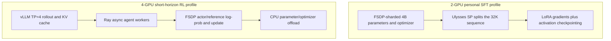

# End-to-end architecture

## Training and inference flow

```mermaid
flowchart LR
    A["REDSearcher raw trajectories"] --> B["Normalize search/visit protocol"]
    B --> C["Prune invalid tools and duplicate turns"]
    C --> D["Correctness filtering"]
    D --> E["Question-level train/val/test split"]
    E --> F["Uniform or 1x/2x/5x sampling"]
    F --> G["Assistant-only multi-turn SFT"]
    G --> H["SFT checkpoint"]

    Q["QA prompt"] --> I["Async vLLM agent rollout"]
    H --> I
    I --> J["search / visit environment"]
    J --> I
    I --> K["Outcome reward and turn boundaries"]
    K --> L["GT log-prob information gain"]
    L --> M["Group normalization and discounted return"]
    M --> N["GRPO-style actor update plus reference KL"]
    N --> O["RL checkpoint"]

    H --> P["Budget-matched evaluation"]
    O --> P
    P --> R["Predictions, metrics, failures, cost"]
```

## SFT call chain

1. `SFT/data_clean/prepare_trajectories.py` converts raw message formats into
   the runtime `search`/`visit` protocol, removes paired invalid turns, checks
   structure, and performs resampling.
2. `SFT/verl/utils/dataset/multiturn_sft_dataset.py` serializes chat messages.
   Only model-generated assistant spans receive `loss_mask=1`; system, user,
   and tool-response tokens remain context but do not contribute to CE loss.
3. `SFT/verl/trainer/fsdp_sft_trainer.py` applies the masked causal-LM loss and
   coordinates FSDP, remove-padding, and Ulysses sequence parallelism.
4. `SFT/train_sft.sh` is the supported configuration boundary. A held-out
   `VAL_FILES` is required unless a smoke test explicitly opts out.

## RL call chain

1. `RL/train_igpo.sh` resolves the experiment profile and starts
   `verl.trainer.main_ppo`.
2. `RL/scrl/llm_agent/dr_agent_loop.py` produces an async multi-turn trajectory
   and records assistant/tool boundaries.
3. `RL/tool_server/` executes search and visit. The personal track can record
   or replay responses through `drvenus_repro.tool_cache`.
4. `RL/verl/utils/reward_score/info_gain.py` maps outcome and information-gain
   rewards into the original token space.
5. `RL/verl/trainer/ppo/info_gain_advantage.py` normalizes IG/outcome signals,
   applies optional IG scaling, and computes turn-discounted returns.
6. `RL/verl/trainer/ppo/ray_trainer.py` broadcasts turn advantage over valid
   response positions, while actor update separately masks non-assistant
   tokens. This distinction lets a tool observation affect credit assignment
   without training the policy to reproduce that observation.

## Resource topology to explain in interviews

The diagrams describe the personal 32K/12-turn protocol, not the official
200K/256K and 200-turn training configuration.
